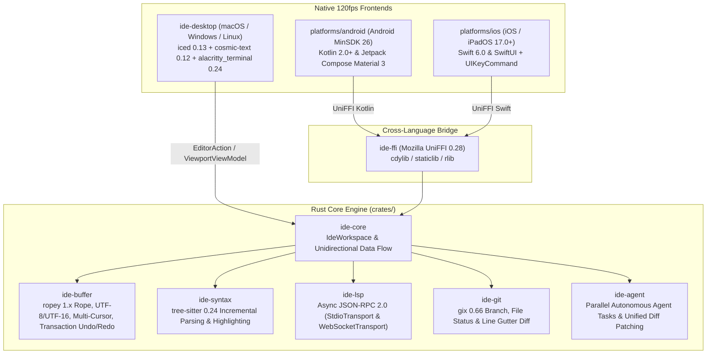

# IDE Levity

**IDE Levity** is a next-generation, high-performance, cross-platform Integrated Development Environment and Autonomous Agentic Coding platform built around a shared Rust core (`ide-core` & `ide-ffi`) and native 120fps frontends across **5 operating systems**: **macOS**, **Windows**, **Linux**, **Android**, and **iOS / iPadOS**.

---

## Architecture & Locked Technology Stack



### Core Crate Responsibilities
| Crate / Directory | Description |
| :--- | :--- |
| `crates/ide-buffer` | `TextBuffer` backed by `ropey::Rope` with O(log N) UTF-8/UTF-16/line-column conversions, multi-cursor editing, transaction-grouped Undo/Redo history, and fast string search. |
| `crates/ide-syntax` | Incremental syntax parsing powered by `tree-sitter = "0.24"` with built-in grammars for **Rust, TypeScript/TSX, JavaScript, Python, JSON, Markdown, Kotlin, and Swift**. Automatically updates syntax trees via `InputEdit` on every buffer mutation and extracts `Vec<HighlightSpan>` for visible viewport lines. |
| `crates/ide-lsp` | Asynchronous JSON-RPC 2.0 Language Server Protocol client supporting `StdioTransport` (Desktop), `WebSocketTransport` (Mobile Remote LSP), and `MockTransport`. Supports `textDocument/didOpen`, `didChange`, `completion`, `hover`, `definition`, and `publishDiagnostics`. |
| `crates/ide-git` | Git engine powered by `gix = "0.66"` (`gitoxide`) for reading current branch names, working tree changed files, and LCS-based per-line gutter diff markers (`Added`, `Modified`, `Deleted`). |
| `crates/ide-agent` | Antigravity-inspired asynchronous AI Agent task orchestrator (`AgentManager`), capable of reading/writing `TextBuffer`, generating Unified Diff patches (`UnifiedDiffPatch`), applying/reverting patches in a single undoable transaction, and tracking verification status. |
| `crates/ide-core` | Unifies all crates inside `IdeWorkspace` with strict Unidirectional Data Flow: `dispatch(EditorAction) -> Result<ViewportViewModel, WorkspaceError>`. Slices only `visible_lines` inside the active viewport to sustain 120fps rendering. |
| `crates/ide-ffi` | Mozilla `uniffi = "0.28"` interface (`cdylib`, `staticlib`, `lib`) and `uniffi-bindgen` binary that generates `.kt` (Kotlin) and `.swift` (Swift) bindings. |
| `crates/ide-desktop` | Cross-platform Desktop GUI (macOS, Windows, Linux) using `iced = "0.13"`, `cosmic-text = "0.12"`, and `alacritty_terminal = "0.24"` with **Dual-View** mode (**Editor View** + **Agent Manager View**) and Command Palette (`Ctrl/Cmd + P`, `Ctrl/Cmd + Shift + P`). |
| `platforms/android` | Native Android project (Kotlin 2.0+, Jetpack Compose Material 3, MinSDK 26) featuring `CodeEditorComposable` (`Canvas` + `TextMeasurer`), programming shortcut toolbar above the virtual keyboard, `ModalNavigationDrawer` file explorer, and `AgentManagerScreen`. |
| `platforms/ios` | Native iOS/iPadOS Swift 6 package & app (iOS 17.0+, SwiftUI) featuring `CodeEditorView` (`NavigationStack` + `InputAccessoryView` on iPhone; `NavigationSplitView` + `UIKeyCommand` hardware keyboard shortcuts on iPad) and `XCFramework` packaging script. |

---

## Building & Running

### 1. Rust Workspace & Desktop Application (Linux, macOS, Windows)
```bash
# Run all unit and integration tests across the workspace
cargo test --workspace

# Run Clippy linter with strict zero-warning policy
cargo clippy --workspace -- -D warnings

# Build and run the Desktop IDE in release mode
cargo build --release -p ide-desktop
./target/release/ide-desktop
```

### 2. Android Native App (`platforms/android`)
```bash
# Build libide_ffi.so and generate UniFFI Kotlin bindings
bash platforms/android/scripts/build-rust-android.sh

# Assemble APK with Gradle
cd platforms/android && gradle assembleDebug
```

### 3. iOS / iPadOS Native App (`platforms/ios`)
```bash
# Build XCFramework and generate UniFFI Swift bindings
bash platforms/ios/scripts/build-xcframework.sh
```
