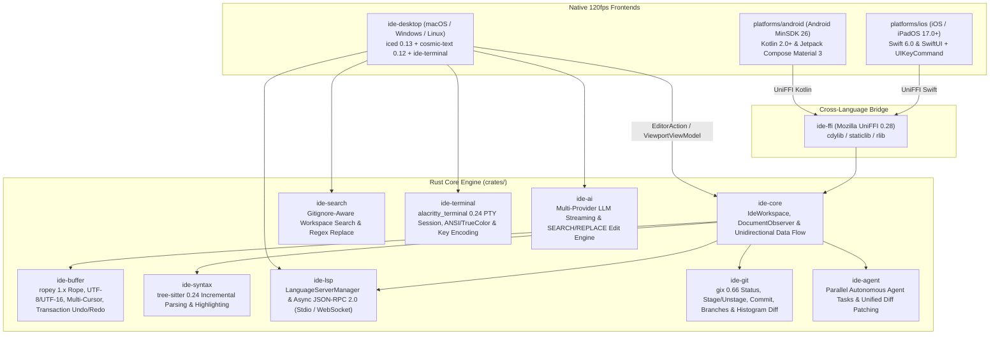

# IDE Levity

**IDE Levity** is a high-performance, cross-platform Integrated Development Environment and Autonomous Agentic Coding platform built around a shared Rust core (`ide-core` & `ide-ffi`) and native 120fps frontends across **5 operating systems**: **macOS**, **Windows**, **Linux**, **Android**, and **iOS / iPadOS**.

---

## Architecture & Locked Technology Stack



### Core Crate Responsibilities

| Crate / Directory | Description |
| :--- | :--- |
| `crates/ide-buffer` | `TextBuffer` backed by `ropey::Rope` with O(log N) UTF-8/UTF-16/line-column conversions, multi-cursor editing, word navigation, auto-indent, block indent/outdent, line comment toggling, save-point dirty tracking, transaction-grouped Undo/Redo history, and fast string search. |
| `crates/ide-syntax` | Incremental syntax parsing powered by `tree-sitter = "0.24"` with built-in grammars for **Rust, TypeScript/TSX, JavaScript, Python, JSON, Markdown, Kotlin, and Swift**. Automatically updates syntax trees via `InputEdit` on every buffer mutation and extracts `Vec<HighlightSpan>` for visible viewport lines. |
| `crates/ide-lsp` | Asynchronous JSON-RPC 2.0 Language Server Protocol client and `LanguageServerManager` supporting `StdioTransport` (Desktop), `WebSocketTransport` (Mobile Remote LSP), and `MockTransport`. Auto-spawns real language servers (`rust-analyzer`, `typescript-language-server`, `pyright-langserver`, `sourcekit-lsp`, `kotlin-language-server`, `vscode-json-language-server`, `marksman`) and handles `didOpen`, `didChange`, `didSave`, `didClose`, `completion`, `hover`, `definition`, and `publishDiagnostics`. |
| `crates/ide-git` | Git engine powered by `gix = "0.66"` (`gitoxide`) and `imara-diff` histogram diffing for reading and switching branches, staging/unstaging files, discarding working tree changes, creating commits, and computing per-line gutter diff markers (`Added`, `Modified`, `Deleted`). |
| `crates/ide-search` | Gitignore-aware project-wide text and regex search and atomic multi-file search-and-replace engine built on `ignore`, `regex`, and `globset`. |
| `crates/ide-terminal` | Real PTY-backed interactive terminal emulator built on `alacritty_terminal = "0.24"` (`tty` + `EventLoop`), supporting full xterm/VT key encoding, bracketed paste, mouse reporting, scrollback, selection, TrueColor/256-color/ANSI palette snapshots, `TIOCSWINSZ` resize, and clean process-group reaping. |
| `crates/ide-ai` | Multi-provider LLM client (`AiClient`) supporting **OpenAI, Anthropic Claude, Google Gemini, OpenRouter, Groq, DeepSeek, Mistral, xAI Grok, Together AI, Ollama, and LM Studio** with SSE token streaming and Aider-style `<<<<<<< SEARCH / ======= / >>>>>>> REPLACE` code edit extraction and application. |
| `crates/ide-agent` | Antigravity-inspired asynchronous AI Agent task orchestrator (`AgentManager`), capable of reading/writing `TextBuffer`, generating Unified Diff patches (`UnifiedDiffPatch`), applying/reverting patches in a single undoable transaction, and tracking verification status. |
| `crates/ide-core` | Unifies all crates inside `IdeWorkspace` with strict Unidirectional Data Flow: `dispatch(EditorAction) -> Result<ViewportViewModel, WorkspaceError>`, expandable directory tree listing, file/folder creation, rename/delete operations, atomic file saving, external file change polling, and `DocumentObserver` hooks. |
| `crates/ide-ffi` | Mozilla `uniffi = "0.28"` interface (`cdylib`, `staticlib`, `lib`) and `uniffi-bindgen` binary that generates `.kt` (Kotlin) and `.swift` (Swift) bindings. |
| `crates/ide-desktop` | Cross-platform Desktop GUI (macOS, Windows, Linux) using `iced = "0.13"` and `cosmic-text = "0.12"` with bundled `JetBrains Mono` font, **Dual-View** mode (**Editor View** + **Agent Manager View**), **Explorer / Search / Source Control** sidebars, integrated **PTY Terminal**, **LSP Completions & Hover**, system clipboard (`Ctrl+C/X/V`), and **Command Palette** (`Ctrl/Cmd + P`, `Ctrl/Cmd + Shift + P`). |
| `platforms/android` | Native Android project (Kotlin 2.0+, Jetpack Compose Material 3, MinSDK 26) featuring `CodeEditorComposable` (`Canvas` + `TextMeasurer`), programming shortcut toolbar above the virtual keyboard, `ModalNavigationDrawer` file explorer, and `AgentManagerScreen`. |
| `platforms/ios` | Native iOS/iPadOS Swift 6 package & app (iOS 17.0+, SwiftUI) featuring `CodeEditorView` (`NavigationStack` + `InputAccessoryView` on iPhone; `NavigationSplitView` + `UIKeyCommand` hardware keyboard shortcuts on iPad) and `XCFramework` packaging script. |

---

## Multi-Provider AI Agent Configuration (`ide-ai`)

IDE Levity automatically detects AI credentials in the following priority order:
1. Explicit environment variables: `LEVITY_AI_PROVIDER`, `LEVITY_AI_MODEL`, `LEVITY_AI_API_KEY`, `LEVITY_AI_BASE_URL`.
2. User configuration file at `~/.config/ide-levity/ai.json`.
3. Standard provider environment variables: `ANTHROPIC_API_KEY`, `OPENAI_API_KEY`, `GEMINI_API_KEY` (or `GOOGLE_API_KEY`), `OPENROUTER_API_KEY`, `GROQ_API_KEY`, `DEEPSEEK_API_KEY`, `MISTRAL_API_KEY`, `XAI_API_KEY`, `TOGETHER_API_KEY`.
4. Local LLM servers: automatically probes Ollama (`http://127.0.0.1:11434`) and LM Studio (`http://127.0.0.1:1234`).
5. Deterministic offline fallback when no API key or local server is reachable.

---

## Building & Running

### 1. Rust Workspace & Desktop Application (Linux, macOS, Windows)

```bash
# Run all unit and integration tests across all 10 workspace crates
cargo test --workspace

# Run Clippy linter with strict zero-warning policy
cargo clippy --workspace -- -D warnings

# Build and run the Desktop IDE in release mode
cargo build --release -p ide-desktop
./target/release/ide-desktop
```

### 2. Android Native App (`platforms/android`)

```bash
# Cross-compile libide_ffi.so for Android ABIs and regenerate UniFFI Kotlin bindings
bash platforms/android/scripts/build-rust-android.sh

# Assemble APK via the Gradle Wrapper
cd platforms/android && ./gradlew assembleDebug
```

### 3. iOS / iPadOS Native App (`platforms/ios`)

```bash
# Build XCFramework and regenerate UniFFI Swift bindings
bash platforms/ios/scripts/build-xcframework.sh
```
